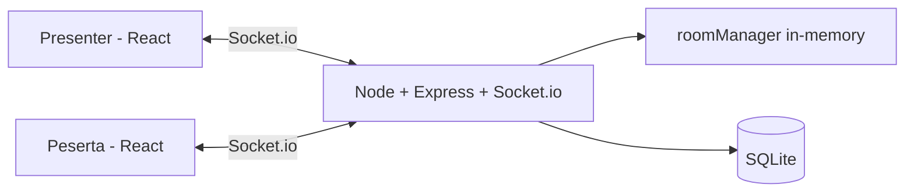
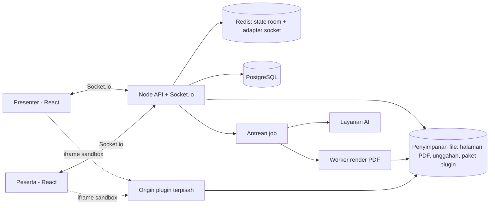

# PRD — InixPoint

| Item | Isi |
|---|---|
| Produk | InixPoint — Platform presentasi interaktif, kuis, gamifikasi, dan game plugin real-time untuk kelas & pelatihan |
| Versi dokumen | 2.1 (draft) — menggantikan v2.0 |
| Tanggal | 2026-11-07 |
| Status produk | MVP v0.1 berjalan lokal; deploy live belum diverifikasi |
| Repo | https://github.com/aqilwahid/InixPoint |
| Owner | _(isi)_ |
| Benchmark konsep | ClassPoint (classpoint.io) — hanya sebagai acuan fitur, bukan acuan paket/harga |

> **Catatan metode.**
> - "Status saat ini" diambil dari PRD v1.0 (kode & dokumen repo); belum diverifikasi ulang terhadap kode.
> - Data ClassPoint diambil dari situs publik per 2026-11-06. Detail teknis internalnya tidak diketahui dan tidak diasumsikan.
> - Angka target (KPI, kapasitas, batas ukuran) adalah **asumsi** yang harus divalidasi.

### Riwayat perubahan

| Versi | Perubahan |
|---|---|
| 1.0 → 2.0 | Positioning "presentasi + interaksi"; modul Deck; matriks gap vs ClassPoint; akun presenter; gamifikasi, aktivitas, AI diperluas; FR/NFR terukur; roadmap bertahap |
| **2.0 → 2.1** | (1) Seluruh bahasan paket/harga ClassPoint dan model bisnis **dihapus**. (2) InixPoint **berdiri sendiri**: materi dimasukkan sebagai **PDF**; opsi PPTX/add-in PowerPoint dihapus. (3) Ditambah **Sistem Plugin Game (Beta)**: instruktur dapat menambahkan game buatan sendiri (bagian 8.9 dan 11). Roadmap dirombak: Plugin Beta = R5, AI = R6, Skala = R7 |

---

## 1. Ringkasan & Positioning

**Pernyataan produk:** InixPoint adalah platform mandiri tempat trainer mengunggah materi (PDF), menyisipkan aktivitas interaktif (kuis, poll, word cloud, game plugin, dll.) di antara halaman materi, dan menjalankannya bersama peserta yang menjawab dari perangkat masing-masing tanpa akun, dengan skor, leaderboard, dan laporan otomatis.

**Pembanding:**

| Produk | Pendekatan | Posisi InixPoint |
|---|---|---|
| ClassPoint | Interaksi di dalam PowerPoint | Acuan konsep "interaksi menyatu dengan materi"; InixPoint tidak bergantung PowerPoint |
| Mentimeter / Slido | Aplikasi web terpisah | Acuan UX peserta & hasil real-time |
| Kahoot | Kuis kompetitif | Acuan gamifikasi |

**Diferensiasi yang diusulkan (perlu divalidasi):**
1. **Standalone:** cukup unggah PDF; tidak perlu PowerPoint atau add-in.
2. **Plugin game buatan instruktur** — kemampuan yang tidak ditemukan pada halaman ClassPoint yang dibaca (verifikasi ulang sebelum diklaim ke publik).
3. Dirancang untuk pelatihan korporat/IT (konteks Inixindo).
4. Bahasa Indonesia sebagai bahasa utama, termasuk AI pembuat soal berbahasa Indonesia.
5. Dapat di-host mandiri (kontrol data).

## 2. Latar Belakang & Masalah

| Masalah | Dampak |
|---|---|
| Kelas/pelatihan satu arah, peserta pasif | Engagement rendah |
| Trainer berpindah antara aplikasi materi dan aplikasi kuis/poll/game | Waktu transisi hilang, alur terputus |
| Presenter tidak tahu pemahaman peserta secara langsung | Materi tidak bisa disesuaikan di tempat |
| Alat yang ada terbatas dalam jenis aktivitas; trainer tidak bisa membawa game/aktivitas sendiri | Aktivitas seragam, cepat membosankan |
| Data peserta berada di pihak ketiga | Kontrol data lemah |
| Rekap hasil manual; tidak ada rekam jejak per peserta lintas sesi | Waktu terbuang, evaluasi sulit |

## 3. Analisis Kompetitor — ClassPoint (fitur saja)

Keputusan: **Ya** = masuk scope · **Tunda** = setelah rilis inti · **Tidak** = sengaja tidak diadopsi.

| Fitur ClassPoint | InixPoint v1 | Keputusan | Rilis |
|---|---|---|---|
| Interaksi menyatu dengan materi presentasi | ⬜ Tidak ada konsep deck | Ya — via deck PDF (bagian 4) | R2 |
| Multiple Choice | ✅ | Pertahankan | — |
| Word Cloud | ✅ | Pertahankan | — |
| Short Answer | ✅ | Pertahankan | — |
| Slide Drawing (peserta menggambar di atas slide) | 🟡 Drawing canvas kosong | Ya (perluas, di atas halaman PDF) | R3 |
| Fill in the Blanks (auto-grade) | ⬜ | Ya | R3 |
| Image Upload | ⬜ | Ya | R3 |
| Audio Record | ⬜ | Tunda | R7 |
| Video Upload | ⬜ | Tunda | R7 |
| Quick Poll | ✅ | Pertahankan | — |
| Matching & Ranking (tidak ada di 8 tipe ClassPoint) | ✅ / ⬜ | Pertahankan / Ya | — / R3 |
| Quiz mode: tingkat kesulitan → bintang, auto-grade | 🟡 | Ya | R3 |
| Quiz summary & laporan Excel | 🟡 CSV ada | Ya (tambah XLSX) | R3 |
| Live submission status (siapa sudah/belum) | ⬜ | Ya | R2 |
| Power search atas jawaban | ⬜ | Ya | R3 |
| Insert hasil jawaban sebagai slide | ⬜ | Ya | R2 |
| Auto start & auto close (timer) | 🟡 | Ya | R1–R2 |
| Anonymous submission | ⬜ | Ya | R3 |
| Live Q&A (pertanyaan peserta + upvote) | ⬜ | Ya | R3 |
| My Class: kelas publik & tersimpan; lock class; allow guest | ⬜ | Ya | R4 |
| Award stars | ✅ | Pertahankan | — |
| Levels (10) & badges | ⬜ | Ya | R4 |
| Leaderboard sesi & kumulatif | 🟡 Hanya sesi | Ya | R4 |
| Grouping + group leaderboard | ⬜ | Ya | R4 |
| Random name picker, timer & stopwatch | ⬜ | Ya | R2 |
| Pen, highlighter, laser, whiteboard | ⬜ | Ya | R2 |
| AI quiz generator dari slide (Bloom, multibahasa) & AI Insights | ⬜ | Ya | R6 |
| Multi-language UI, custom branding | ⬜ | Ya (ID/EN; branding Inixindo) | R4 |
| Webhook access | ⬜ | Tunda | R7 |
| Musik latar, share activity ke guru lain | ⬜ | Tunda | R7 |
| Draggable objects pada slide | ⬜ | **Tidak** — deck PDF statis, tidak ada objek yang bisa dipindah | — |
| Add-in PowerPoint / integrasi PowerPoint | — | **Tidak** — InixPoint standalone | — |
| Sertifikasi/komunitas/academy; kepatuhan SOC 2/FERPA/COPPA | — | **Tidak** pada v1 (lihat bagian 10 untuk privasi yang relevan) | — |
| **Plugin game buatan instruktur** | — (tidak ada di ClassPoint yang dibaca) | **Ya — beta** | R5 |

## 4. Keputusan: Deck Standalone via PDF

InixPoint tidak mengintegrasikan PowerPoint. Materi masuk sebagai **PDF**; trainer yang memakai PPTX mengekspornya ke PDF di alat masing-masing sebelum mengunggah.

| Aspek | Ketentuan |
|---|---|
| Format masukan | PDF saja. PPTX/DOCX ditolak dengan pesan yang mengarahkan ekspor ke PDF |
| Batas (asumsi) | Maks 100 halaman dan 50 MB per deck; PDF terenkripsi/berkata sandi ditolak |
| Pemrosesan | Setiap halaman dirender menjadi gambar saat unggah, disimpan, lalu disajikan ke presenter dan (opsional) peserta. Perenderan di server agar tampilan seragam di semua perangkat; alat perenderan dipilih saat implementasi (D-5) |
| Slide aktivitas | Disisipkan di antara halaman PDF; konfigurasi tersimpan bersama deck |
| Yang hilang akibat PDF | Animasi, transisi, dan video tertanam tidak ada. Ini **diterima** sebagai trade-off standalone |
| Pengeditan materi | Dilakukan di luar InixPoint; unggah ulang menghasilkan versi baru. Aktivitas yang sudah disisipkan dipertahankan berdasarkan nomor halaman, dengan peringatan bila jumlah halaman berubah |

**Syarat diterima:** perenderan deck 50 halaman < 60 detik dan semua halaman terbaca jelas di layar proyektor dan ponsel pada 10 PDF sampel Inixindo (diukur manual).

## 5. Tujuan & Non-Tujuan

### Tujuan
1. Peserta bergabung < 15 detik tanpa akun (kode/QR + nama).
2. Trainer dapat mengunggah PDF materi dan menyisipkan aktivitas tanpa membangun ulang materi.
3. Jawaban muncul di layar presenter < 1 detik p95 pada jaringan normal (*asumsi*).
4. Mendukung tipe aktivitas yang beragam, kuis berskor, dan gamifikasi lintas sesi.
5. Instruktur dapat memasang game buatan sendiri melalui sistem plugin yang aman (beta).
6. Presenter memiliki akun; peserta tetap bisa masuk sebagai tamu.
7. Laporan sesi dan per peserta dapat diunduh (CSV, XLSX).
8. Pembuatan soal dibantu AI, termasuk bahasa Indonesia.
9. Nyaman dipakai di ponsel (mobile-first untuk peserta; presenter tetap usable di mobile).

### Non-Tujuan
- Editor slide (membuat/mengedit isi materi di dalam InixPoint).
- Integrasi PowerPoint atau format selain PDF.
- Video/audio conferencing.
- Aplikasi native (hanya web).
- Eksekusi kode plugin di server pada fase beta (lihat 11.8).
- Marketplace publik plugin dan monetisasi plugin.
- Model paket/penagihan.

## 6. Persona

| Persona | Deskripsi | Kebutuhan utama |
|---|---|---|
| **Presenter (Trainer)** | Trainer/instruktur/dosen/fasilitator; punya materi dalam PDF | Unggah PDF, sisipkan aktivitas cepat, kontrol real-time, laporan |
| **Peserta** | Peserta pelatihan/siswa, umumnya di ponsel | Join mudah, jawab cepat, umpan balik instan, lihat peringkat & bintang |
| **Pembuat plugin** *(baru)* | Instruktur yang bisa membuat HTML/JS dan ingin membawa game sendiri | SDK jelas, tempat uji lokal, cara membagikan game ke kelas |
| **Admin/Owner** | Penyelenggara/Inixindo | Deploy, data terkendali, branding, persetujuan & pencabutan plugin |

## 7. User Journey

**Presenter:** Masuk (akun) → buat/pilih kelas → unggah PDF → sisipkan aktivitas pada halaman yang diinginkan (kuis, poll, game plugin, atau minta AI membuatkan) → mulai sesi, tampilkan kode/QR → presentasikan; saat tiba di halaman aktivitas, aktivitas dimulai otomatis atau manual → lihat jawaban real-time & status submit → tutup aktivitas, sisipkan hasil sebagai halaman → leaderboard → akhiri sesi → unduh laporan.

**Peserta:** Buka beranda / scan QR → isi kode & nama (tamu) atau pilih nama dari kelas tersimpan → tunggu → jawab aktivitas atau main game → lihat benar/salah, skor, bintang, level → lihat leaderboard.

**Pembuat plugin:** Baca dokumentasi SDK → ambil template → bangun game → uji di Plugin Playground (simulasi presenter + peserta di satu halaman) → unggah paket → pratinjau → pakai pribadi atau bagikan ke kelas → (opsional) ajukan ke katalog organisasi → admin menyetujui/menolak.

## 8. Ruang Lingkup Fitur

Status: ✅ ada · 🟡 parsial/perlu verifikasi · ⬜ belum. Rilis merujuk bagian 16.

### 8.1 Deck & Presentasi *(modul baru)*
| ID | Fitur | Prioritas | Status | Rilis |
|---|---|---|---|---|
| D-01 | Unggah PDF dan render menjadi gambar per halaman (aturan di bagian 4) | P0 | ⬜ | R2 |
| D-02 | Mode presentasi: navigasi halaman, layar penuh, kontrol keyboard | P0 | ⬜ | R2 |
| D-03 | Sisipkan slide aktivitas di antara halaman PDF | P0 | ⬜ | R2 |
| D-04 | Aktivitas dimulai otomatis saat slide aktivitas ditampilkan (opsi auto-start) | P1 | ⬜ | R2 |
| D-05 | Sisipkan hasil aktivitas (word cloud, jawaban, grafik) sebagai halaman baru | P1 | ⬜ | R2 |
| D-06 | Slide broadcasting: peserta melihat halaman yang sedang tampil di perangkatnya | P2 | ⬜ | R3 |
| D-07 | Simpan & kelola deck milik presenter; unggah ulang sebagai versi baru | P1 | ⬜ | R2 |
| D-08 | Ekspor deck + hasil sesi sebagai PDF | P2 | ⬜ | R4 |

### 8.2 Room, Kelas & Akses
| ID | Fitur | Prioritas | Status | Rilis |
|---|---|---|---|---|
| F-01 | Buat room dengan judul & kode unik | P0 | ✅ | — |
| F-02 | Join via kode + nama | P0 | ✅ | — |
| F-03 | QR code join (modal responsif) | P0 | ✅ | — |
| F-04 | Daftar peserta real-time (join/leave/disconnect) | P0 | ✅ | — |
| F-05 | Reconnect peserta ke room tanpa kehilangan skor | P0 | 🟡 | R1 |
| F-06 | Tutup room / sesi selesai | P0 | 🟡 | R1 |
| F-07 | Kelas publik (siapa pun dengan kode) dan kelas tersimpan (progres bertahan lintas sesi) | P1 | ⬜ | R4 |
| F-08 | Kunci kelas (lock) setelah sesi dimulai | P1 | ⬜ | R4 |
| F-09 | Izinkan/blokir tamu | P1 | ⬜ | R4 |
| F-10 | Kick peserta & blokir nama tidak pantas | P1 | ⬜ | R1 |
| F-11 | Daftar kelas: impor peserta (CSV) | P2 | ⬜ | R4 |

### 8.3 Tipe Aktivitas
| ID | Tipe | Prioritas | Status | Rilis |
|---|---|---|---|---|
| Q-01 | Multiple choice (opsional kunci jawaban) | P0 | ✅ | — |
| Q-02 | Word cloud | P0 | ✅ | — |
| Q-03 | Short answer | P0 | ✅ | — |
| Q-04 | Drawing canvas | P1 | ✅ | — |
| Q-05 | Matching | P1 | ✅ | — |
| Q-06 | Quick poll (Likert 5, Yes/No, True/False, Rating 5), dapat dijalankan spontan | P1 | ✅ | — |
| Q-07 | Ranking | P2 | ⬜ (tipe ada di `shared`) | R3 |
| Q-08 | Fill in the blanks (satu kata, auto-grade, daftar jawaban benar) | P1 | ⬜ | R3 |
| Q-09 | Image upload (kamera/galeri; ukuran dibatasi) | P1 | ⬜ | R3 |
| Q-10 | Slide drawing (peserta menggambar di atas halaman PDF aktif, kirim hasilnya) | P2 | ⬜ | R3 |
| Q-11 | Live Q&A: peserta bertanya & upvote; presenter tandai terjawab/abaikan; toggle on/off | P1 | ⬜ | R3 |
| Q-12 | Audio record | P3 | ⬜ | R7 |
| Q-13 | Video upload | P3 | ⬜ | R7 |
| Q-14 | **Plugin game** (menjalankan game dari plugin; lihat 8.9) | P1 | ⬜ | R5 |

### 8.4 Kontrol Presenter & Quiz Mode
| ID | Fitur | Prioritas | Status | Rilis |
|---|---|---|---|---|
| P-01 | Start / close aktivitas | P0 | ✅ | — |
| P-02 | Hasil jawaban real-time per tipe | P0 | ✅ | — |
| P-03 | Timer per aktivitas dengan **auto-close**; hitung mundur tampil di presenter & peserta | P0 | 🟡 | R1 |
| P-04 | Poin per jawaban benar (`pointsPerCorrect`) | P1 | ✅ | — |
| P-05 | Berikan bintang manual (`award-star`) | P2 | ✅ | — |
| P-06 | Tingkat kesulitan (mudah/sedang/sulit) → jumlah bintang otomatis | P1 | ⬜ | R3 |
| P-07 | Status submit live: siapa sudah/belum mengirim; lihat jawaban per peserta | P1 | ⬜ | R2 |
| P-08 | Pencarian kata kunci pada jawaban (power search) | P2 | ⬜ | R3 |
| P-09 | Mode anonim (nama peserta disembunyikan pada hasil yang ditampilkan) | P2 | ⬜ | R3 |
| P-10 | Ringkasan kuis di akhir sesi | P1 | ⬜ | R3 |
| P-11 | Pemilih nama acak | P2 | ⬜ | R2 |
| P-12 | Timer & stopwatch bebas | P2 | ⬜ | R2 |
| P-13 | Alat anotasi saat presentasi: pen, highlighter, laser pointer, whiteboard | P2 | ⬜ | R2 |

### 8.5 Gamifikasi
| ID | Fitur | Prioritas | Status | Rilis |
|---|---|---|---|---|
| G-01 | Skor otomatis untuk jawaban benar | P0 | ✅ | — |
| G-02 | Leaderboard sesi (podium + tabel) | P1 | ✅ | — |
| G-03 | Metrik kecepatan (rata-rata detik) | P1 | ✅ | — |
| G-04 | Bintang ⭐ | P2 | ✅ | — |
| G-05 | Leaderboard kumulatif lintas sesi (kelas tersimpan) | P1 | ⬜ | R4 |
| G-06 | Level (10 tingkat) dengan ambang bintang yang dapat dikustomisasi | P2 | ⬜ | R4 |
| G-07 | Badge per level, tampil di layar presenter & perangkat peserta | P2 | ⬜ | R4 |
| G-08 | Grouping: otomatis dan manual | P2 | ⬜ | R4 |
| G-09 | Leaderboard grup | P2 | ⬜ | R4 |

### 8.6 AI
| ID | Fitur | Prioritas | Status | Rilis |
|---|---|---|---|---|
| A-01 | Pembuat soal dari teks halaman PDF: pilih tipe soal, jumlah, bahasa (termasuk Indonesia) | P1 | ⬜ | R6 |
| A-02 | Level taksonomi Bloom sebagai parameter | P2 | ⬜ | R6 |
| A-03 | Presenter wajib meninjau/mengedit soal AI sebelum dipakai | P0 (syarat A-01) | ⬜ | R6 |
| A-04 | AI Insights: ringkasan pemahaman kelas, topik yang perlu diulang, peserta yang kesulitan | P2 | ⬜ | R6 |
| A-05 | Pengelompokan jawaban short answer/word cloud sejenis | P3 | ⬜ | R6 |

> PDF hasil pindaian (gambar tanpa teks) tidak dapat dibaca A-01; perlu OCR atau pengguna memasukkan teks manual (diputuskan saat R6).

### 8.7 Pelaporan, Data & Integrasi
| ID | Fitur | Prioritas | Status | Rilis |
|---|---|---|---|---|
| R-01 | Ekspor CSV | P0 | ✅ | — |
| R-02 | Persistensi SQLite | P1 | ✅ | — |
| R-03 | Ekspor XLSX (ringkasan + detail per peserta + per pertanyaan) | P1 | ⬜ | R3 |
| R-04 | Riwayat sesi & laporan kelas milik presenter | P1 | ⬜ | R4 |
| R-05 | Dashboard analitik per pertanyaan | P2 | ⬜ | R4 |
| R-06 | Migrasi ke PostgreSQL | P1 | ⬜ | R4 |
| R-07 | Webhook (sesi selesai, skor akhir) | P3 | ⬜ | R7 |

### 8.8 Akun, Branding & Lokalisasi
| ID | Fitur | Prioritas | Status | Rilis |
|---|---|---|---|---|
| U-01 | Registrasi/login presenter (metode final di D-1) | P1 | ⬜ | R4 |
| U-02 | Token host pada pembuatan room | P0 | ⬜ | R1 |
| U-03 | Branding kustom (logo, palet Inixindo) | P2 | ⬜ | R4 |
| U-04 | UI dwibahasa ID/EN | P2 | ⬜ | R4 |
| U-05 | Pengaturan retensi & hapus data sesi/peserta | P1 | ⬜ | R4 |

### 8.9 Sistem Plugin Game — **Beta** *(fitur baru)*

Instruktur dapat membuat game sendiri, memasangnya ke InixPoint, dan memainkannya bersama peserta sebagai satu jenis aktivitas (Q-14). Desain dan model keamanan: bagian 11.

| ID | Fitur | Prioritas | Status | Rilis |
|---|---|---|---|---|
| PL-01 | Format paket plugin: `.zip` berisi `manifest.json`, `index.html`, dan aset statis (CSS/JS/gambar/audio); batas 5 MB (*asumsi*) | P0 | ⬜ | R5 |
| PL-02 | Manifest: id, nama, versi, deskripsi, pembuat, tampilan yang didukung, jumlah peserta min/maks, mode skor, skema konfigurasi yang diisi instruktur | P0 | ⬜ | R5 |
| PL-03 | SDK JavaScript (`ix`) untuk komunikasi plugin ↔ InixPoint (11.3) | P0 | ⬜ | R5 |
| PL-04 | Eksekusi plugin dalam iframe ter-sandbox pada origin terpisah, tanpa akses jaringan keluar (11.6) | P0 | ⬜ | R5 |
| PL-05 | Slide aktivitas tipe "Plugin game" di deck: pilih plugin, isi konfigurasi, atur timer & penghitungan skor | P0 | ⬜ | R5 |
| PL-06 | Relay pesan presenter ↔ peserta lewat server dengan batas ukuran & laju | P0 | ⬜ | R5 |
| PL-07 | Skor plugin dibatasi manifest; presenter memilih apakah skor dihitung ke leaderboard; ditandai sumber "plugin" | P0 | ⬜ | R5 |
| PL-08 | Unggah & kelola plugin milik instruktur (versi, hapus) | P1 | ⬜ | R5 |
| PL-09 | Berbagi plugin: privat / ke kelas tertentu via tautan / katalog organisasi (butuh persetujuan admin) | P1 | ⬜ | R5 |
| PL-10 | Review admin: pratinjau, setujui, tolak, **cabut (kill switch)** | P1 | ⬜ | R5 |
| PL-11 | Plugin Playground: uji plugin lokal dengan simulasi presenter + beberapa peserta di satu halaman | P1 | ⬜ | R5 |
| PL-12 | Dokumentasi SDK, template, dan 2 plugin contoh bawaan | P1 | ⬜ | R5 |
| PL-13 | Flag beta: fitur nonaktif secara default; diaktifkan per akun presenter (allowlist) | P0 | ⬜ | R5 |
| PL-14 | Hasil plugin (skor, ringkasan hasil) masuk laporan sesi | P1 | ⬜ | R5 |
| PL-15 | Watchdog: plugin yang tidak merespons atau melanggar batas dihentikan; peserta/presenter melihat pesan jelas dan sesi tetap berjalan | P0 | ⬜ | R5 |
| PL-16 | Lapor plugin bermasalah oleh presenter | P2 | ⬜ | R5 |

## 9. Kebutuhan Fungsional

| ID | Kebutuhan | Cara uji |
|---|---|---|
| FR-1 | Kode room unik, 6 karakter alfanumerik tanpa karakter ambigu (0/O, 1/I), tidak dapat diurutkan; kode salah menampilkan pesan error jelas | Uji otomatis: 10.000 kode tanpa duplikat |
| FR-2 | Hanya host (diverifikasi via token host, bukan hanya `socket.id`) yang boleh `start-question`, `close-question`, `award-star`, kick, kontrol deck, dan kontrol plugin. Host dapat reconnect dengan token yang sama | Uji: event dari klien non-host ditolak |
| FR-3 | Aturan jumlah jawaban per aktivitas didefinisikan per tipe: satu jawaban (MC, Fill-in, Matching, Poll, Ranking); beberapa dengan batas (Word cloud, maks 3 — *asumsi*); kiriman terakhir menggantikan (Drawing, Image) | Uji per tipe |
| FR-4 | Jawaban hanya diterima saat aktivitas `active` dan sebelum timer habis (dicek di server) | Uji: kirim setelah close → ditolak |
| FR-5 | Skor dihitung server-side; klien tidak dipercaya. **Pengecualian terkontrol:** skor dari plugin diterima sebagai klaim, dibatasi oleh `maxPointsPerRound` manifest dan hanya dihitung bila presenter mengizinkan (FR-18) | Uji: manipulasi payload tidak mengubah skor aktivitas bawaan; klaim plugin di atas batas dipotong |
| FR-6 | Leaderboard diperbarui otomatis setelah aktivitas ditutup | Uji E2E |
| FR-7 | Ekspor memuat: peserta, pertanyaan, jawaban, benar/salah, poin, bintang, durasi respons, kelompok, sumber skor (bawaan/plugin) | Cocokkan dengan sesi uji |
| FR-8 | Timer berjalan di server; klien hanya menampilkan. Saat habis, aktivitas ditutup otomatis dan semua klien menerima `question-closed` | Uji: selisih tampilan antar klien < 1 detik |
| FR-9 | Peserta yang terputus dan tersambung kembali dalam 5 menit (*asumsi*) mempertahankan nama, skor, dan jawaban yang sudah dikirim | Uji: putus/sambung |
| FR-10 | Perenderan PDF berjalan asinkron dengan status progres; kegagalan (file korup, terenkripsi, melebihi batas) menampilkan alasan dan tidak merusak deck lain | Uji: file bermasalah |
| FR-11 | Setiap slide aktivitas menyimpan konfigurasinya (tipe, kunci, timer, poin, kesulitan, auto-start, plugin & konfigurasinya) bersama deck | Uji: buka ulang deck |
| FR-12 | Soal hasil AI tidak pernah dijalankan ke peserta sebelum presenter menyetujuinya | Uji alur |
| FR-13 | Nama peserta dalam satu room unik (duplikat ditolak atau diberi akhiran — D di bagian 18) | Uji |
| FR-14 | Teks dari peserta disanitasi sebelum dirender (anti-XSS) dan difilter kata kasar (daftar dapat dikonfigurasi) | Uji payload XSS |
| FR-15 | Presenter dapat menyembunyikan jawaban tertentu dari layar publik | Uji |
| FR-16 | Versi plugin yang dipakai pada sebuah sesi dikunci; pembaruan plugin tidak mengubah sesi yang sedang berjalan | Uji: unggah versi baru saat sesi aktif |
| FR-17 | Pesan plugin yang melebihi batas ukuran (4 KB) atau laju (10 pesan/detik/peserta) — *asumsi* — dibuang server dan dicatat | Uji beban pesan |
| FR-18 | Presenter memilih per aktivitas plugin: skor dihitung ke leaderboard / hanya ditampilkan di layar plugin | Uji |
| FR-19 | Plugin dengan status dicabut tidak dapat dimuat; sesi yang memakainya menampilkan pesan dan melanjutkan ke slide berikutnya | Uji kill switch |
| FR-20 | Plugin tidak menerima data pribadi peserta selain id sesi anonim dan nama tampilan | Uji: inspeksi payload `init` |

## 10. Kebutuhan Non-Fungsional

| Area | Target (asumsi, perlu validasi) |
|---|---|
| Latensi update | < 1 detik (p95) di jaringan normal |
| Kapasitas | R1–R5: 200 peserta/room pada 1 instance, **diuji** dengan simulasi beban; R7: hingga 500 dengan Redis adapter |
| Browser | Chrome, Edge, Safari, Firefox versi terbaru; iOS Safari & Android Chrome |
| Responsif | Tanpa overflow horizontal di lebar ≥ 360px |
| Aksesibilitas | Kontras ≥ WCAG AA, label form, target sentuh ≥ 44px, tidak mengandalkan warna saja untuk benar/salah |
| Keamanan | Validasi input di server; batas ukuran payload (drawing, image, PDF); sanitasi teks; CORS terbatas; rate limit join & submit; token host; unggahan divalidasi tipe & ukuran; keamanan plugin pada bagian 11 |
| Privasi & kepatuhan | Peserta tanpa akun: simpan hanya nama tampilan & jawaban. Data presenter diproses sesuai UU Pelindungan Data Pribadi (UU No. 27 Tahun 2022) — perlu ditinjau pihak legal. Konten halaman PDF yang dikirim ke penyedia AI memerlukan persetujuan eksplisit presenter |
| Retensi | Ditentukan di D-3 (usulan awal 12 bulan, dapat dihapus manual) |
| Ketersediaan | Best-effort sampai R4; setelahnya target 99% bulanan (*asumsi*) |
| Observabilitas | Log terstruktur, health check, metrik room/peserta aktif, error rate socket, jumlah plugin dimuat/dihentikan watchdog |
| Lokalisasi | Bahasa Indonesia utama; Inggris pada R4 |

## 11. Sistem Plugin Game (Beta) — Desain

Seluruh angka dan nama API di bagian ini adalah **usulan** yang dimatangkan lewat spike keamanan di awal R5.

### 11.1 Konsep
- Plugin adalah game web statis (HTML/JS/CSS + aset) yang berjalan di dalam InixPoint pada dua tampilan: **presenter-view** (layar proyektor) dan **participant-view** (ponsel peserta).
- Plugin **tidak punya backend sendiri** dan tidak punya akses internet. Semua komunikasi lewat relay InixPoint.
- Plugin dipasang sebagai aktivitas di slide (Q-14), dikonfigurasi oleh instruktur, dan hasilnya masuk laporan.

### 11.2 Paket & manifest (contoh)

```json
{
  "id": "tebak-cepat",
  "name": "Tebak Cepat",
  "version": "1.0.0",
  "author": "nama instruktur",
  "views": ["presenter", "participant"],
  "participants": { "min": 2, "max": 200 },
  "scoring": { "mode": "points", "maxPointsPerRound": 100 },
  "config": {
    "rounds": { "type": "integer", "default": 5, "min": 1, "max": 20 },
    "theme":  { "type": "string", "enum": ["terang", "gelap"], "default": "terang" }
  }
}
```

`config` diubah menjadi formulir otomatis di editor slide (PL-05) sehingga instruktur lain bisa memakai plugin tanpa mengubah kode.

### 11.3 SDK (usulan API)

| API | Arah | Fungsi |
|---|---|---|
| `ix.onInit(ctx)` | InixPoint → plugin | Menerima `role` (presenter/participant), `config`, `participant {sessionId, displayName}`, `participantCount` |
| `ix.send(msg)` | peserta → presenter | Kirim pesan ke tampilan presenter |
| `ix.broadcast(msg)` | presenter → semua peserta | Kirim pesan ke semua peserta |
| `ix.sendTo(sessionId, msg)` | presenter → satu peserta | Pesan terarah |
| `ix.onMessage(handler)` | InixPoint → plugin | Menerima pesan relay |
| `ix.submitScore(points, meta)` | plugin → InixPoint | Mengajukan skor peserta (dipotong oleh `maxPointsPerRound`) |
| `ix.end(result)` | presenter-view → InixPoint | Mengakhiri game dan menyerahkan ringkasan hasil |

### 11.4 Alur eksekusi
1. Presenter tiba di slide plugin (atau menekan Start).
2. Server membuat *plugin session*, mengunci versi plugin (FR-16), mengirim `plugin-started`.
3. Klien presenter dan peserta memuat plugin dalam iframe ter-sandbox; plugin menerima `onInit`.
4. Pesan plugin melewati relay server (dibatasi ukuran & laju, FR-17).
5. Plugin memanggil `submitScore`; server memotong sesuai manifest dan mencatat (FR-5, FR-18).
6. Game berakhir lewat `ix.end`, timer habis, atau presenter menutup aktivitas.
7. Hasil masuk leaderboard (bila diizinkan) dan laporan (PL-14).

### 11.5 Model kepercayaan skor

| Sumber skor | Dipercaya? | Perlakuan |
|---|---|---|
| Aktivitas bawaan (MC, Fill-in, dll.) | Ya, dihitung server | Skor resmi |
| Plugin | Tidak (kode instruktur berjalan di peranti peserta) | Klaim dibatasi `maxPointsPerRound`; ditandai "plugin"; hanya masuk leaderboard bila presenter mengizinkan; dapat dikecualikan dari bintang/level |

Konsekuensinya diterima secara sadar: peserta yang paham teknis dapat memalsukan klaim skor plugin sampai batas manifest. Karena itu skor plugin default tidak dihitung ke level/badge kumulatif.

### 11.6 Ancaman & kontrol

| Ancaman | Kontrol |
|---|---|
| Plugin mencuri sesi/data InixPoint (XSS) | Dimuat dari **origin terpisah**; iframe `sandbox` **tanpa** `allow-same-origin`; tidak ada cookie/token InixPoint di origin plugin |
| Plugin mengirim data keluar | CSP ketat (tanpa koneksi jaringan keluar, tanpa frame/form eksternal); hanya aset dari paketnya sendiri |
| Plugin mengarahkan halaman/membuka popup | Sandbox tanpa izin navigasi top-level dan popup |
| Plugin mengakses kamera/mikrofon/lokasi | Kebijakan izin perangkat dinonaktifkan |
| Plugin menghabiskan CPU/baterai | Watchdog heartbeat; presenter dapat menghentikan; batas ukuran paket |
| Spam pesan ke server/peserta lain | Batas ukuran & laju pesan; pesan dibuang bila melanggar |
| Kecurangan skor | Batas skor per ronde; penanda sumber; opsi dikecualikan dari leaderboard |
| Konten tidak pantas / berbahaya dalam paket | Validasi isi paket (tipe file yang diizinkan, ukuran); review admin untuk katalog; tombol lapor; kill switch |
| Plugin crash | Error boundary per iframe; sesi tetap berjalan (PL-15) |
| Plugin lama memengaruhi sesi berjalan | Penguncian versi per sesi (FR-16) |

Seluruh desain wajib ditinjau keamanan sebelum fitur dibuka ke pengguna selain allowlist.

### 11.7 Tata kelola & siklus hidup plugin

`Draft` → `Privat` (hanya pemilik) → `Dibagikan` (ke kelas tertentu via tautan) → `Menunggu review` → `Disetujui katalog` / `Ditolak` → `Dicabut`.

- Privat dan dibagikan ke kelas tidak butuh persetujuan admin, tetapi tetap berjalan dalam sandbox yang sama.
- Katalog organisasi hanya berisi plugin yang disetujui admin.
- Siapa yang boleh mengunggah dan aturan persetujuan: D-4.

### 11.8 Batasan beta

- Tanpa eksekusi kode di server; tanpa penyimpanan persisten per plugin (hanya skor & ringkasan hasil).
- Tanpa jaringan eksternal, kamera, mikrofon, lokasi.
- Hanya aset statis (HTML/JS/CSS/gambar/audio).
- Tanpa marketplace publik dan tanpa monetisasi.
- Aktif hanya untuk akun presenter dalam allowlist (PL-13).
- Mensyaratkan akun presenter (U-01), token host (U-02), dan penyimpanan file (bagian 12).

## 12. Arsitektur & Stack

### 12.1 Saat ini (v0.1)


### 12.2 Target (R4–R7)


| Lapisan | Teknologi saat ini | Tambahan target |
|---|---|---|
| Frontend | React, TypeScript, Vite, Tailwind CSS, `qrcode.react` | Penampil halaman deck; host iframe plugin; i18n |
| Real-time | Socket.io | Redis adapter (R7); relay pesan plugin |
| Backend | Node.js, Express, TypeScript | Auth (sesi/JWT), antrean job, API plugin |
| State aktif | In-memory (`server/src/roomManager.ts`) | Redis |
| Persistensi | SQLite (`node:sqlite`) | PostgreSQL (R-06), volume persisten sampai migrasi |
| Penyimpanan file | — | Volume persisten dulu (R2), object storage S3-compatible kemudian |
| Render PDF | — | Worker terpisah; alat dipilih di D-5 |
| Hosting plugin | — | Domain/origin terpisah dari aplikasi utama |
| AI | — | Penyedia LLM (D-2) |
| Kontrak | Paket `shared/` | Tetap sumber tunggal tipe event & model; ditambah kontrak SDK plugin |
| Deploy | Vercel (client), Railway (server) — belum diverifikasi live | Worker, storage, dan origin plugin di host yang mendukung proses persisten |

### 12.3 Event Socket.io

**Sudah ada.**
- Client → Server: `create-room`, `join-room`, `start-question`, `close-question`, `submit-answer`, `award-star`, `leave-room`
- Server → Client: `room-state`, `participant-joined`, `participant-left`, `participant-updated`, `star-awarded`, `question-started`, `question-closed`, `answer-received`, `room-closed`, `error-message`

**Usulan tambahan.**
- Client → Server: `goto-slide`, `kick-participant`, `lock-room`, `submit-question-qna`, `upvote-qna`, `mark-qna`, `set-groups`, `rejoin-room` (dengan token), `plugin-message`, `plugin-score`, `plugin-end`
- Server → Client: `slide-changed`, `qna-updated`, `groups-updated`, `level-up`, `participant-kicked`, `room-locked`, `plugin-started`, `plugin-message`, `plugin-stopped`

## 13. Model Data

**Inti saat ini:** `Room` → `participants`, `questions`, `answers` · `Question` (type, prompt, options, timeLimitSec, status, pointsPerCorrect) · `Answer` (content, isCorrect, pointsAwarded, responseDurationSec, starsEarned) · `Participant` (score, stars, averageSpeedSec). Definisi lengkap: `shared/src/index.ts`.

**Entitas baru:**

| Entitas | Atribut kunci | Catatan |
|---|---|---|
| `User` (presenter) | id, email, nama, penyedia login, peran (presenter/admin) | R4 |
| `Class` | id, ownerId, nama, tipe (publik/tersimpan), kunci, izinTamu | |
| `ClassMember` | classId, nama, bintangKumulatif, level | Dasar leaderboard kumulatif |
| `Deck` | id, ownerId, judul, berkasPdf, statusRender, jumlahHalaman, versi | R2 |
| `Slide` | deckId, urutan, tipe (`page` / `activity`), gambarUrl, configAktivitas | Slide aktivitas menyimpan konfigurasi |
| `Session` | id, classId?, deckId?, kodeRoom, mulai, selesai | |
| `Group` / `GroupMember` | sessionId, nama, anggota | |
| `Badge` / `LevelRule` | levelKe, ambangBintang, ikon | Dapat dikustomisasi per kelas |
| `Media` | id, ownerId, tipe, ukuran, url | Unggahan gambar/audio/video |
| `QnaItem` | sessionId, teks, upvote, status | |
| `Plugin` | id, ownerId, slug, nama, status (draft/privat/dibagikan/menunggu/disetujui/ditolak/dicabut) | R5 |
| `PluginVersion` | pluginId, versi, manifestJson, berkasUrl, checksum, ukuran | Versi dikunci per sesi |
| `PluginShare` | pluginId, classId?, tautan, kedaluwarsa | Berbagi ke kelas |
| `PluginRun` | sessionId, pluginVersionId, slideId, config, mulai, selesai, ringkasanHasil | Masuk laporan |
| `PluginScore` | pluginRunId, participantId, poin, dipotong (bool), dihitungKeLeaderboard (bool) | Sumber skor |

## 14. Risiko & Batasan

| Risiko | Dampak | Mitigasi |
|---|---|---|
| **Plugin: kode pihak ketiga berjalan di peranti peserta** | Pencurian data, penyalahgunaan sesi | Origin terpisah, sandbox, CSP, review, kill switch, allowlist beta, tinjauan keamanan sebelum rilis (bagian 11) |
| Pembuat plugin harus bisa menulis HTML/JS | Sedikit instruktur yang memakai; fitur sepi | Template + 2 contoh bawaan; Plugin Playground; pertimbangkan pembuatan plugin dibantu AI setelah beta (pertanyaan terbuka 7) |
| Skor plugin dapat dipalsukan | Leaderboard tidak adil | Batas per ronde, penanda sumber, default tidak masuk level/badge |
| Plugin buggy atau lambat di ponsel lama | Pengalaman peserta buruk | Watchdog, error boundary, batas ukuran paket, uji pada ponsel mid-range |
| PDF kehilangan animasi/video | Trainer kecewa dibanding pengalaman PowerPoint | Diterima sebagai trade-off standalone; komunikasikan sejak awal |
| PDF besar/kompleks gagal dirender | Deck tidak bisa dipakai | Batas ukuran/halaman, pesan error jelas, uji 10 PDF sampel |
| State room in-memory | Restart server = sesi aktif hilang; tidak bisa multi-instance | Snapshot state periodik; Redis + adapter Socket.io (R7) |
| Vercel tidak mendukung WebSocket server persisten | Server harus di host terpisah | Railway; pastikan CORS & URL env benar |
| SQLite pada filesystem ephemeral | Data hilang saat redeploy | Volume persisten, lalu PostgreSQL |
| Payload besar (drawing, image, PDF, paket plugin) | Memori/bandwidth/biaya storage | Batas ukuran; kompresi sisi klien; kuota per presenter |
| Tanpa autentikasi host | Pihak lain meniru presenter | Token host (U-02, FR-2) pada R1 |
| Spam / nama / konten tidak pantas | Gangguan sesi | Rate limit, kick, filter kata, moderasi presenter |
| Soal AI salah atau bias | Evaluasi tidak adil | Wajib tinjau (A-03); label "dibuat AI" |
| Konten halaman dikirim ke penyedia AI | Kebocoran materi | Persetujuan eksplisit; data peserta tidak dikirim ke AI |
| Cakupan fitur luas untuk tim kecil | Rilis molor | Roadmap bertahap; tiap rilis layak dipakai sendiri |
| Fitur ala ClassPoint belum tentu dibutuhkan trainer Inixindo | Pemborosan | Validasi dengan 3–5 trainer sebelum R3/R4 |

## 15. Metrik Keberhasilan (asumsi awal)

| Metrik | Target |
|---|---|
| Waktu join peserta | < 15 detik |
| Rasio peserta menjawab / join | > 80% per aktivitas |
| Sesi selesai tanpa error kritis | > 95% |
| Waktu dari buka app → aktivitas pertama aktif (dengan PDF) | < 5 menit; tanpa deck < 2 menit |
| Rasio sesi yang memakai deck PDF (setelah R2) | > 60% |
| Waktu render PDF 50 halaman | < 60 detik |
| Rata-rata aktivitas per sesi | ≥ 3 |
| Pemakaian ekspor laporan per sesi | > 50% |
| Trainer aktif berulang (≥ 2 sesi dalam 30 hari) | > 50% |
| Kepuasan trainer (survei singkat, skala 5) | ≥ 4,0 |
| **Plugin (beta):** jumlah instruktur yang mengunggah ≥ 1 plugin | ≥ 3 pada 60 hari pertama beta |
| **Plugin (beta):** sesi yang memakai plugin tanpa crash/dihentikan watchdog | > 95% |
| **Plugin (beta):** insiden keamanan | 0 |

## 16. Roadmap & Rilis

| Rilis | Fokus | Isi utama | Status |
|---|---|---|---|
| **R0** | UI & desain sistem; fitur dasar | Landing, Presenter, Peserta, palet Inixindo; Q-01…Q-06; G-01…G-04; R-01, R-02 | ✅ |
| **R1** | Stabilisasi & deploy | Deploy Vercel + Railway diuji live; token host (U-02); timer penuh + auto-close (P-03); reconnect (F-05); tutup room (F-06); kick & filter (F-10); rate limit; self-check server lulus | ⬜ |
| **R2** | Deck PDF & pengalaman presenter | D-01…D-05, D-07; P-07, P-11, P-12, P-13 | ⬜ |
| **R3** | Paritas aktivitas & quiz mode | Q-07…Q-11; P-06, P-08…P-10; R-03; D-06 | ⬜ |
| **R4** | Akun, kelas, gamifikasi lanjutan | U-01, U-03…U-05; F-07…F-09, F-11; G-05…G-09; R-04…R-06; D-08 | ⬜ |
| **R5** | **Plugin Game (Beta)** | PL-01…PL-16, Q-14; tinjauan keamanan; allowlist | ⬜ |
| **R6** | AI | A-01…A-05 | ⬜ |
| **R7** | Skala & ekstensi | Redis adapter & 500 peserta; Q-12, Q-13; R-07; musik latar; share activity | ⬜ |

Prinsip: tiap rilis harus bisa dipakai di kelas sungguhan; rilis berikutnya tidak dimulai sebelum kriteria rilis sebelumnya terpenuhi.

Ketergantungan R5: akun presenter (U-01), token host (U-02), penyimpanan file, dan origin terpisah untuk plugin. Bila plugin ingin didahulukan, minimal U-01 dan U-02 harus dimajukan ke sebelum R5.

## 17. Kriteria Penerimaan

**R1 — Stabilisasi**
- [ ] Presenter membuat room dan peserta join via kode **dan** QR di perangkat berbeda.
- [ ] Q-01…Q-06 berjalan end-to-end dengan hasil tampil real-time.
- [ ] Skor & leaderboard benar untuk MC dan Matching.
- [ ] Timer menutup aktivitas otomatis; selisih tampilan antar klien < 1 detik.
- [ ] Klien non-host tidak dapat menjalankan kontrol presenter (diuji dengan klien palsu).
- [ ] Peserta yang terputus dapat kembali dengan skor utuh.
- [ ] CSV terunduh dan isinya cocok dengan sesi.
- [ ] Tanpa overflow horizontal di 393px (presenter & peserta).
- [ ] Deploy live (Vercel + Railway) berfungsi dengan WebSocket.
- [ ] Self-check server (`server/src/test-*.ts`) lulus.
- [ ] Uji beban 200 peserta simulasi pada 1 room: latensi p95 < 1 detik, tanpa error.

**R2 — Deck PDF**
- [ ] PDF 50 halaman terender < 60 detik; semua halaman terbaca pada 10 PDF sampel.
- [ ] PPTX/DOCX ditolak dengan pesan jelas; PDF terenkripsi dan melebihi batas ditolak.
- [ ] Aktivitas dapat disisipkan di antara halaman, tersimpan, dan berjalan saat slide aktivitas tampil.
- [ ] Hasil aktivitas dapat disisipkan sebagai halaman.
- [ ] Presenter melihat siapa yang sudah/belum submit secara live.

**R3 — Aktivitas & quiz mode**
- [ ] Setiap tipe baru (Q-07…Q-11) end-to-end, termasuk batas ukuran unggahan.
- [ ] Tingkat kesulitan menghasilkan bintang sesuai aturan; laporan XLSX memuat ringkasan + detail.

**R4 — Akun & kelas**
- [ ] Bintang kumulatif tersimpan lintas sesi untuk kelas tersimpan; leaderboard kumulatif benar.
- [ ] Level & badge muncul di layar presenter dan perangkat peserta.
- [ ] Grouping otomatis & manual; leaderboard grup benar.
- [ ] Data berpindah ke PostgreSQL tanpa kehilangan sesi uji.

**R5 — Plugin Game (Beta)**
- [ ] Plugin contoh bawaan diunggah, dikonfigurasi di slide, dan dimainkan presenter + ≥ 20 peserta simulasi tanpa error.
- [ ] Plugin uji berperilaku jahat **gagal** pada semua skenario: membaca cookie/penyimpanan aplikasi utama, request jaringan keluar, navigasi top-level, popup, akses kamera/mikrofon.
- [ ] Pesan melebihi batas ukuran/laju dibuang; klaim skor di atas `maxPointsPerRound` dipotong.
- [ ] Plugin yang hang dihentikan watchdog dan sesi tetap berjalan.
- [ ] Kill switch: plugin dicabut tidak dapat dimuat; sesi melanjutkan ke slide berikutnya.
- [ ] Penguncian versi: unggah versi baru saat sesi aktif tidak mengubah sesi berjalan.
- [ ] Fitur hanya terlihat oleh akun dalam allowlist; hasil plugin tampil di laporan dengan penanda sumber.
- [ ] Tinjauan keamanan independen selesai dan temuan kritis ditutup.

**R6 — AI**
- [ ] Soal dari 10 PDF sampel berbahasa Indonesia dihasilkan; ≥ 70% dinilai layak pakai oleh 3 trainer tanpa suntingan besar (*asumsi*).
- [ ] Tidak ada soal AI yang berjalan tanpa persetujuan presenter.

## 18. Keputusan & Pertanyaan Terbuka

**Keputusan yang harus ditutup:**

| ID | Keputusan | Memblokir | Rekomendasi |
|---|---|---|---|
| D-1 | Metode login presenter: email, Google, Microsoft | R4 | Microsoft + email |
| D-2 | Penyedia & kebijakan data AI | R6 | Tentukan setelah D-3 |
| D-3 | Retensi dan penghapusan data peserta | R4 | Usulan 12 bulan, hapus manual |
| D-4 | Tata kelola plugin: siapa boleh mengunggah; apakah berbagi ke kelas butuh review; kriteria persetujuan katalog | R5 | Unggah hanya akun allowlist; katalog wajib review admin; berbagi ke kelas tanpa review |
| D-5 | Cara render PDF (alat dan lokasi: server vs klien) | R2 | Server, hasil disimpan sebagai gambar |

**Pertanyaan lain:**
1. Siapa target utama: internal Inixindo, kelas publik, atau komersial?
2. Batas peserta per room yang sebenarnya dibutuhkan (100 / 200 / 500)?
3. Nama peserta duplikat: tolak atau beri akhiran otomatis?
4. Apakah word cloud perlu lebih dari satu jawaban per peserta?
5. Apakah peserta di kelas tersimpan perlu login, atau cukup memilih nama dari daftar?
6. Perlu dukungan jaringan intranet tanpa internet publik? (memengaruhi hosting plugin dan AI)
7. Apakah pembuat plugin yang ditargetkan memang instruktur yang bisa menulis HTML/JS? Bila tidak, perlu jalur pembuatan plugin dibantu AI atau editor low-code — di luar scope beta ini.
8. Plugin game contoh apa yang paling bernilai untuk pelatihan Inixindo (menentukan 2 contoh bawaan)?

## 19. Referensi

- Internal: `README.md`, `DEVELOPMENT.md`, `DEPLOYMENT.md`, `VISUALIZATION.md`, `COLLABORATION.md`, `shared/src/index.ts`.
- ClassPoint (diakses 2026-11-06): https://www.classpoint.io/ · https://www.classpoint.io/interactive-quiz-questions · https://www.classpoint.io/gamification
